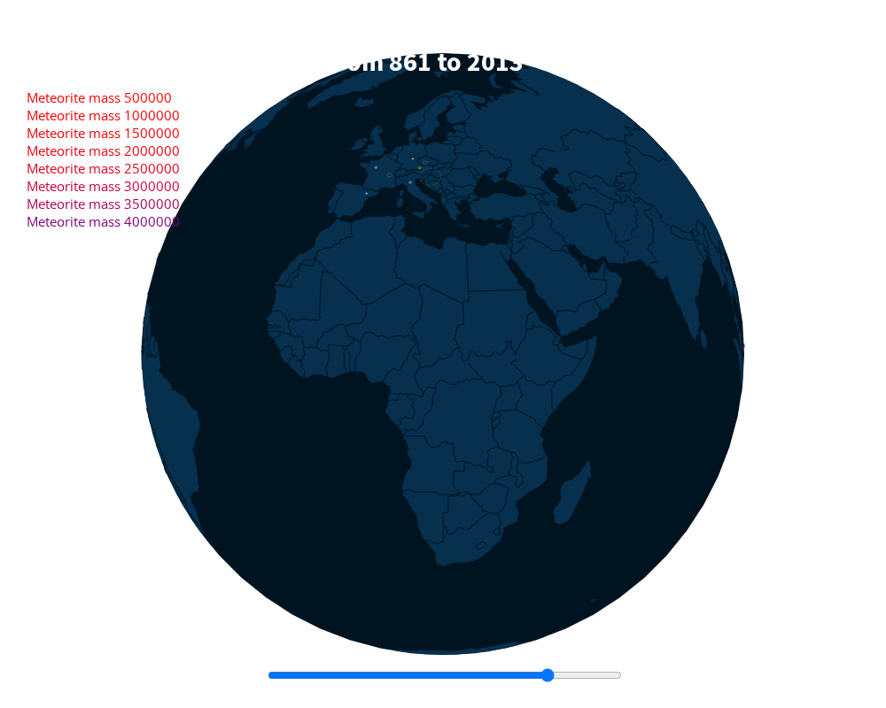

# nasa-meteor-to-planetaryjs

Meteorite landings recorded by NASA from 861 to 2013, replayed year by year on a rotating 3D globe in the browser. Built in one weekend at the NASA Space Apps Challenge hackathon (October 2020).



## What it does

`index.html` draws a spinning globe with [Planetary.js](https://github.com/BinaryMuse/planetary.js) and plays back the landings of NASA's *Meteorite Landings* dataset over about a minute, from the year 861 to 2013. Each meteorite pings at its landing site, coloured and sized by its mass (white for a few grams, up to purple for tonnes). A slider shows the current year; drag it to jump through time.

`converter.py` turns the dataset (`nasa-datas.json`, 1,000 records from NASA's open data portal) into the time-sorted list the globe reads (`year_quakes_small.json`: 961 entries, of which 922 carry a date and a position and are played back). The playback code is adapted from Planetary.js's earthquake example, hence the file names.

## Status

Hackathon prototype, finished on 4 October 2020 and not developed since. It runs in a current browser.

- Works: the globe, the playback from 861 to 2013, the mass colours and the slider.
- Rough edges: the page refers to a background image and a stylesheet that are not in the repository, so it shows on a white background and the page title is partly hidden behind the globe; the playback goes quickly through the early centuries, where landings are rare. `converter.py` removes items from the list it is iterating over, so it leaves 39 records unconverted in its output (the globe ignores them) and keeps 2 that lack a mass or a location.
- `index.html` also loads jQuery, a Font Awesome kit, typed.js, Waypoints, Owl Carousel and Google Fonts from CDNs that the page does not use, so it needs network access.
- Leftovers from the hackathon, not used by the page: `planetaryjs-datas.json` (earthquake data from the original example), `sky.jpg` and the `.BAK` files.

## Getting started

The page loads its data with `XMLHttpRequest`, so it must be served over HTTP, not opened as a file:

```sh
git clone https://github.com/storagebits/nasa-meteor-to-planetaryjs.git && cd nasa-meteor-to-planetaryjs
python3 -m http.server 8000      # then open http://localhost:8000/
```

To rebuild the playback data from `nasa-datas.json` (needs Python 3 with `pytz` and `python-dateutil`):

```sh
python3 converter.py > year_quakes_small.json
```

## Configuration

None. The playback speed (`realToData`, one minute for the whole span), the mass colour scale and the rotation speed are constants in `quake.js`.

## Project layout

```
index.html               the page
quake.js                 globe set-up and playback (adapted from the Planetary.js earthquake example)
converter.py             NASA dataset → year_quakes_small.json
nasa-datas.json          NASA Meteorite Landings, first 1,000 records
year_quakes_small.json   the playback data
world-110m.json          world map (TopoJSON)
*.min.js, *.css          bundled third-party libraries (see below)
docs/screenshot.png      the image above
```

## Licence and credits

Made by an international team of six people during the NASA Space Apps Challenge 2020.

The team's code (`index.html`, `quake.js`, `converter.py`) is released under the [MIT licence](LICENSE). The bundled third-party files keep their own licences:

- [Planetary.js](https://github.com/BinaryMuse/planetary.js) 1.1.2 by Michelle Tilley (MIT); `quake.js` is adapted from its earthquake example.
- [D3](https://d3js.org/) v3 and [TopoJSON](https://github.com/topojson/topojson) v1 by Mike Bostock (BSD 3-Clause); `world-110m.json` comes from [Natural Earth](https://www.naturalearthdata.com/) (public domain) via the TopoJSON world atlas.
- [Moment.js](https://momentjs.com/) 2.5.0 (MIT), [Semantic UI](https://semantic-ui.com/) 0.10.2 (MIT) and the [Prism](https://prismjs.com/) default theme by Lea Verou (MIT).
- Data: [Meteorite Landings](https://data.nasa.gov/) from NASA's open data portal, compiled by The Meteoritical Society.
